<h1 align="center">
  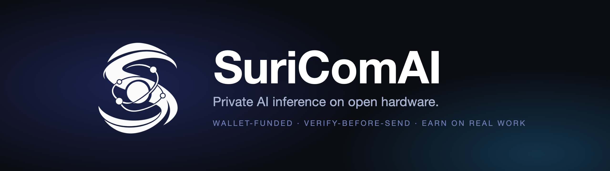
</h1>

<p align="center">
  <b>SuriComAI is an early prototype of a decentralized, private AI inference network.</b><br>
  Pick an approved model, pay per job, and keep your prompt sealed. Hardware owners earn by running models, relaying traffic, and checking proofs.
</p>

<p align="center">
  <a href="LICENSE"></a>
  
  
  
</p>

<p align="center">
  <a href="#prototype-notice">Prototype notice</a> ·
  <a href="#desktop-app">Desktop app</a> ·
  <a href="#what-is-suricomai">What is SuriComAI</a> ·
  <a href="#what-works-today">What works today</a> ·
  <a href="#how-a-job-works">How it works</a> ·
  <a href="#quick-start">Quick start</a> ·
  <a href="#repository-layout">Repository</a> ·
  <a href="#faq">FAQ</a> ·
  <a href="#licensing-purchase-and-takeover">Licensing</a>
</p>

> [!NOTE]
> **Available for acquisition.** SuriComAI is for sale. The owner will sell the project, or license it, to a serious buyer who has a defined need for it. To start a conversation, see [Licensing, purchase and takeover](#licensing-purchase-and-takeover).

---

## Prototype notice

> [!WARNING]
> **SuriComAI is a prototype. It is not a product you can use yet.**
>
> - **There is no live network.** No public nodes, no wallet, no paid jobs, and no token exist today.
> - **Nothing is private.** Hardware-backed privacy (Intel TDX, AMD SEV-SNP) is not built. On a normal computer the client labels answers `lab-untrusted` or `not-private`. Do not send secrets, personal data, or anything sensitive.
> - **Do not put real funds anywhere near it.** The escrow contract and committee signer are unaudited reference code and are not deployed.
> - **Do not trust any site, app, token, or airdrop that claims to be SuriComAI.** This repository is the only official source, and it has no token.
>
> The code here is a working reference you can run and read on your own machine. See [What works today](#what-works-today) and [Real and not real](#real-and-not-real) for the exact line between built and not built.

## What is SuriComAI

**SuriComAI** is a proprietary prototype, written in Rust, of a decentralized network for **private AI inference**. Users would pay per job from a wallet, hardware owners would earn by running approved models, and auditors would verify proofs without seeing any conversation. This repository holds the protocol, a reference client, a reference escrow contract, and two independent proof verifiers. It does not yet hold a running network.

The goal is an open network for **private AI inference**. It would give you the feel of a hosted AI product (choose a model, stream answers, see the price before you send) without tying you to one company's datacenter.

- **For users:** pay per job from a wallet. No flat subscription.
- **For hardware owners:** earn by doing useful work on your own CPU or GPU, not by solving empty hash puzzles.
- **For auditors:** verify that the right model ran, using proofs, without ever seeing the conversation.

The network has two layers:

| Layer | Job | Never holds |
| --- | --- | --- |
| **Settlement** | Holds fees in escrow, pays workers on valid proofs, refunds users, and slashes bonds. | Prompts, answers, or their ciphertext. |
| **Execution market** | Runs sealed jobs on executors and carries them through relays. | The power to move funds or rewrite history. |

<p align="center">
  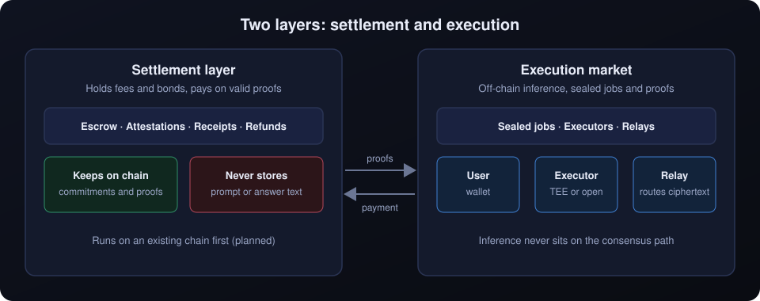
</p>

### At a glance

| | |
| --- | --- |
| **Category** | Decentralized AI inference, DePIN, confidential computing |
| **Status** | Prototype. Runs locally. No public network. |
| **Language** | Rust, plus a Python verifier and a Solidity escrow contract |
| **Encryption** | HPKE with X-Wing (ML-KEM-768 + X25519), post-quantum hybrid |
| **Private tier hardware** | Intel TDX and AMD SEV-SNP (planned, not built) |
| **Payments** | Per job, stablecoin escrow on an existing Ethereum layer-2 (planned, not deployed) |
| **Token** | None |
| **License** | Proprietary, all rights reserved. See [Licensing](#licensing-purchase-and-takeover). |

## What works today

With the Owner's written permission (see [Licensing](#licensing-purchase-and-takeover)) you can run the whole sealed-job flow on your own machine: seal a prompt, run a model, get a sealed answer and a proof, audit the proof with two independent verifiers, and settle the payment on a local test chain.

| Area | State |
| --- | --- |
| Sealed prompt envelope, receipts, proof audit | **Working** (Rust) |
| Proofs bound to the assigned worker and the exact contract | **Working**, checked by both verifiers |
| Job escrow rules and settlement simulator | **Working**, in-process |
| Reference chat client (`suricomai`) with a model list | **Working**, runs locally |
| Signed model manifests and approvals (approve, expire, revoke) | **Working** |
| Independent proof verifier | **Working** (Python, same test vectors) |
| Escrow smart contract and committee signer | **Reference implementation, unaudited.** Runs end to end on a local test chain. |
| Hardware-backed private tier (Intel TDX, AMD SEV-SNP) | **Next.** Today it uses a lab quote, so it is not private. |
| Paid jobs on a public chain, wallet, public network | **Planned** |
| Payment channels, mobile wallet | **Planned** |

**Prototype, in plain terms.** This is the foundation of the network, not a service you can pay for yet. Two things to know before you rely on it:

- **Nothing here is private against the machine running it.** On a normal computer the client says `lab-untrusted` for the sealed path and `not-private` for the local text model. It never claims hardware privacy, and it never will until a real hardware quote verifies.
- **The contract and the signer are unaudited and not deployed.** Do not put real funds in them.

## How a job works

<p align="center">
  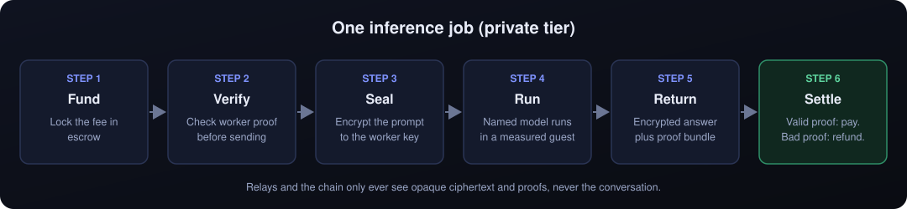
</p>

1. **Fund.** The fee is locked in escrow before any work starts.
2. **Verify.** On the private tier, your client checks the worker's attestation **before** your prompt leaves your device.
3. **Seal.** The prompt is encrypted to the worker's key. Relays only see padded, opaque bytes.
4. **Run.** The named model runs inside the agreed environment.
5. **Return.** You get an encrypted answer and a proof bundle.
6. **Settle.** A valid proof pays the worker. A bad proof, wrong machine, replay, or expired job pays nothing.

### Privacy tiers

The tier is always shown before you send.

| Tier | Who can read the prompt and answer | Use it for |
| --- | --- | --- |
| **P2 Private** | You and a verified hardware enclave only. | Sensitive work |
| **P1 Sealed transit** | Encrypted in transit. The worker process can read it. | Everyday jobs where you trust the worker |
| **P0 Open** | Anyone involved. | Benchmarks, tests, public tasks |

### Security design

- **Fail closed.** Any check that fails means no payment and no silent downgrade of privacy.
- **Post-quantum hybrid encryption.** Prompts are sealed with HPKE using X-Wing (ML-KEM-768 + X25519), SHAKE256, and ChaCha20-Poly1305.
- **Canonical encoding.** Control messages use strict canonical CBOR. Anything non-canonical is rejected.
- **Padding and buckets.** Prompts and answers are padded, and token counts are bucketed, to limit metadata leaks.
- **Replay and expiry protection.** The same proof cannot be paid twice, and expired jobs cannot be settled.
- **No unsafe Rust.** The core crates use `#![forbid(unsafe_code)]`.
- **Two verifiers.** Rust and Python independently check the same proof vectors, so one bug cannot silently change the rules.

## Quick start

> [!IMPORTANT]
> **This code is not open source.** You may read it, and you may not run, copy, modify, fork, rename or redistribute it without the Owner's written permission. The steps below are for people who have that permission. See [Licensing](#licensing-purchase-and-takeover).

You need [Rust](https://rustup.rs) (stable). It is developed and tested on macOS. Linux and Windows are not tested yet.

```bash
git clone https://github.com/suraj-chavda/suricomai-network.git
cd suricomai-network
cargo run -p suricomai-runtime --features lab --bin suricomai
```

The `lab` feature is required. It switches on the development node: a software quote, a built-in test model, and a public development approver key. Without the feature the crate refuses to build, because there is no hardware-backed node yet. See [Real and not real](#real-and-not-real).

This opens an interactive chat. Your message is sealed and sent to a local executor in the same process.

The default model, `suricomai-tiny-v1`, is a tiny test model that answers in hex. It exists to exercise the sealed path end to end, not to be a useful assistant.

### Chat commands

| Command | What it does |
| --- | --- |
| *(any text)* | Send a prompt |
| `/help` | List commands |
| `/models` | List models |
| `/model <name>` | Switch to an approved model from `/models` |
| `/status` | Show privacy label, model, temperature, and token cap |
| `/proof` | Show the last receipt |
| `/temp <0.0-2.0>` | Set temperature |
| `/tokens <1-256>` | Set the answer length cap |
| `/clear` | Forget this chat |
| `/quit` | Exit |

You can also pipe a single prompt:

```bash
echo "hello" | cargo run -p suricomai-runtime --features lab --bin suricomai
```

### Which models you can use

Every model is identified by a content hash, not a name, and every model carries a signed **manifest** (what it is, who published it, its license) and a signed **approval** from a trusted approver. Approvals have an end date, can be revoked, and are checked every time.

- **Private jobs** use approved models only. Once hardware-backed privacy exists, the secure hardware will be allowed to load approved models only.
- **Non-private jobs** use approved models by default. The client library can allow an unapproved model for a non-private job, labeled as such. The command-line chat does not expose that switch yet.
- **You can publish a model, but it only counts for people who trust your approvers.** A publisher signs a manifest. Approvers named in each operator's own trust file sign an approval, and a deployment can require several of them. Any one trusted approver can revoke. A node hosts a model only if its weights, tokenizer and runtime match the manifest, and it checks approval again before every job. Hosted models are not private: the node that hosts one can read your prompt. The step-by-step flow, including how to take a model down, is in [Publishing a model](docs/publishing-models.md).
- **An approval is not a safety guarantee.** It means an approver vouches for exact weights. It does not prove the model is harmless.
- **Nothing uploads weights to the network.** Only small signed records travel, through a registry that nobody has to trust. Weights stay in files on the machine that hosts them.
- `/models` lists each model with its standing (approved, expired, revoked) and its privacy label.

The default chat uses a built-in lab catalog with two entries, both approved by a development-only key that is public in the source: the built-in test model and the optional SmolLM2 model below. Nodes and clients that use `--trust` read their approvers from their own file and never use that key.

### Get readable answers (optional)

For real text answers, get the small open model SmolLM2-135M-Instruct and put two files in the `models/` folder:

- A Q4_K_M GGUF build of SmolLM2-135M-Instruct, saved with this **exact file name**: `SmolLM2-135M-Instruct-Q4_K_M.gguf`
- The model's `tokenizer.json`

Both come from the model's page on Hugging Face. The weights are not part of this repository. After that, `/models` lists it as approved, and `/model smollm2-135m-instruct` switches to it. It runs on your machine and is labeled `not-private`.

### Run a node and a client as separate processes

Start a development node in one terminal. It prints a ticket and its address:

```bash
cargo run -p suricomai-runtime --features lab --bin suricomai-node
```

In a second terminal, send it a prompt with that ticket:

```bash
cargo run -p suricomai-runtime --features lab --bin suricomai-ask -- 127.0.0.1:7700 <ticket> "hello"
```

The two processes talk over an authenticated Noise channel, and the prompt is still sealed inside it. The ticket pins the node's transport key and carries its lab quote root. The node's card binds that transport key into its quote, and the client refuses a card whose key differs from the one it connected with. This is still a development build: the answer is `lab-untrusted` and not private. By default keys are fresh on every start, so a restarted node needs a new ticket. Add `--key-file node.key` to keep the transport identity across restarts: the file is created with mode 0600, a file that is not exactly the safe form is refused and left alone, and the encryption and receipt keys are never written to disk.

### Send a job through a relay

A relay carries the bytes of the node channel and cannot read, change, or forge them. It holds no keys. Give it the node address as a fixed upstream, then reach the node through it:

```bash
cargo run -p suricomai-runtime --features lab --bin suricomai-relay -- --upstream 127.0.0.1:7700
cargo run -p suricomai-runtime --features lab --bin suricomai-ask -- --via 127.0.0.1:7800/0 127.0.0.1:7700 <ticket> "hello"
```

`--via RELAY/INDEX` names a relay and the position of the node in its upstream list. Clients never name an address to a relay, so it cannot be used to reach other hosts. Routes are tried in order, then the direct route unless you pass `--no-direct`. A route that fails before the request is sent moves on to the next one. A route that fails after it is sent is not retried, because the node may already have run the job. A single relay does not hide you from the node or the node from you: it sees your address and which node you asked for, but not the prompt or the answer.

### Find a node through a directory

A directory lists nodes a client can try. It is an index and a hint: it connects to every address published to it, checks the node's card itself, and stores only what that check returned. A client that picks a listed node still checks that node's card on its own, so a directory cannot make a client trust a node whose quote does not verify. A directory also refuses to connect to loopback and private addresses unless you pass `--allow-local`, which a one-machine setup needs.

```bash
# the node prints its ticket; the last part of it is the lab quote root
cargo run -p suricomai-runtime --features lab --bin suricomai-node -- --key-file node.key
cargo run -p suricomai-runtime --features lab --bin suricomai-directory -- --allow-local --accept-lab-root <root>
cargo run -p suricomai-runtime --features lab --bin suricomai-node -- --key-file node.key --announce <directory-addr>/<directory-key>
cargo run -p suricomai-runtime --features lab --bin suricomai-ask -- --directory <directory-addr>/<directory-key> --lab-root <root> --allow-local "hello"
```

A directory can also learn from other directories with `--peer <directory-addr>/<directory-key>`. It treats every address a peer lists as a claim and admits it only after its own check, so a peer cannot add or change an entry, and at most 16 claims per peer are checked per round.

When you give the client a directory instead of a ticket, it chooses the node: it checks up to 8 listed nodes at once, keeps the ones whose card passes every check, and picks at random among those near the fastest it measured. If the pick cannot be reached it tries the next one. It never retries on another node once a request has been sent, because the first node may already have run the job. This is a choice made by your client, not a network assignment: nothing in the receipt proves the node was assigned.

This is a development setup on one machine. Nothing here has run across separate machines yet.

### Run the examples

```bash
# Seal, run, answer, and audit one job end to end
cargo run -p suricomai-envelope --example roundtrip

# Multi-role settlement simulation with fees, burns, relays, and an impostor
cargo run -p suricomai-testnet --example gates

# One local OpenAI-style POST /v1/chat/completions request
cargo run -p suricomai-runtime --features lab --example chat_api
```

### Run the tests

Some tests run the independent Python verifier, so set it up first:

```bash
python3 -m venv verifiers/python/.venv
verifiers/python/.venv/bin/pip install -r verifiers/python/requirements.txt
verifiers/python/.venv/bin/python verifiers/python/audit_proof.py vectors/audit-v1.json   # Windows: .venv\Scripts\python.exe
```

Then the Rust tests:

```bash
cargo test --workspace
cargo clippy --workspace --all-targets -- -D warnings
```

Test the escrow contract and run the whole flow on a local chain (needs Docker):

```bash
contracts/run.sh "forge test"
contracts/e2e.sh
```

## Desktop app

A desktop window for the local node, for macOS, Windows and Linux. It follows the style of each system, keeps a status bar in view, and walks a new person through the first run. It is a development build: answers are labelled `lab-untrusted` or `not-private`, and there is no wallet, payment or token. Details are in [docs/desktop-app.md](docs/desktop-app.md), and platform support is in [docs/platforms.md](docs/platforms.md).

<p align="center">
  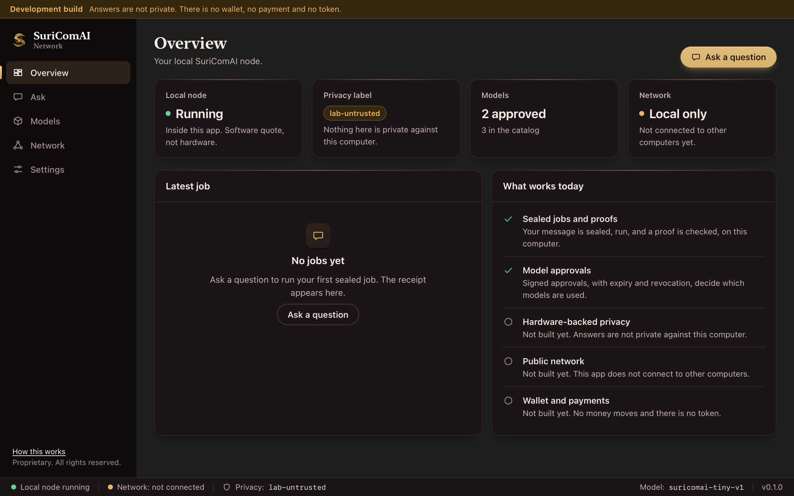
</p>
<p align="center"><sub><b>Overview.</b> Node status, the privacy label, approved models and what is and is not built yet.</sub></p>

<table>
  <tr>
    <td width="50%">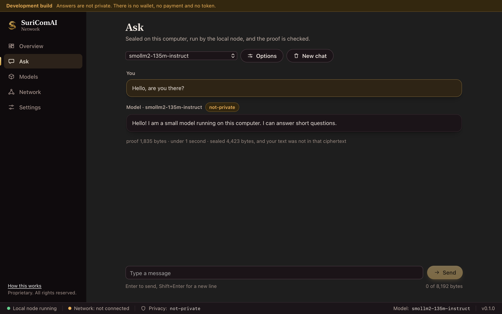</td>
    <td width="50%">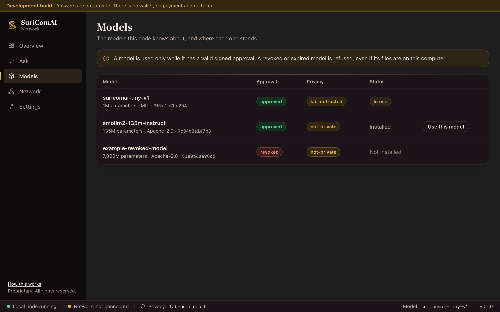</td>
  </tr>
  <tr>
    <td><sub><b>Ask.</b> Every answer carries the privacy label and the size of its checked proof.</sub></td>
    <td><sub><b>Models.</b> Approval standing, privacy and fingerprint for each model.</sub></td>
  </tr>
  <tr>
    <td>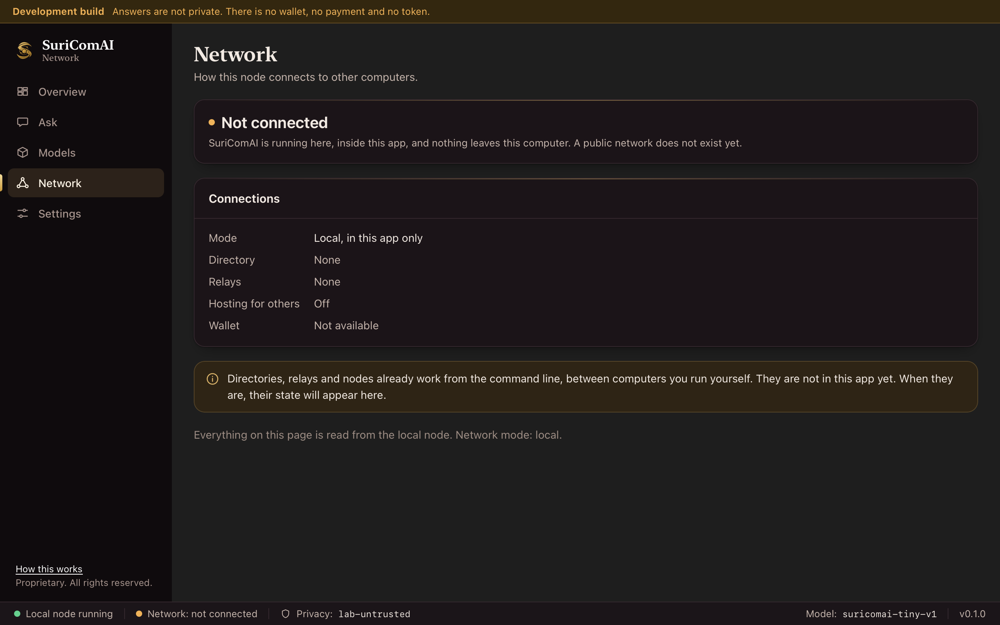</td>
    <td>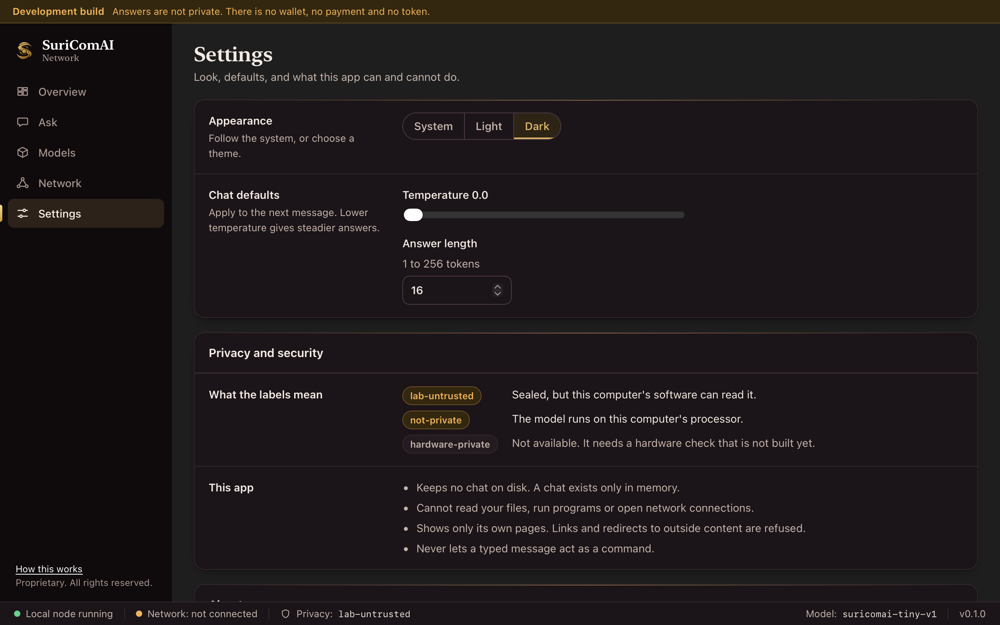</td>
  </tr>
  <tr>
    <td><sub><b>Network.</b> What the app is connected to, stated plainly.</sub></td>
    <td><sub><b>Settings.</b> Appearance, generation limits, and the security notes.</sub></td>
  </tr>
</table>

### Made for each system

<table>
  <tr>
    <td width="50%">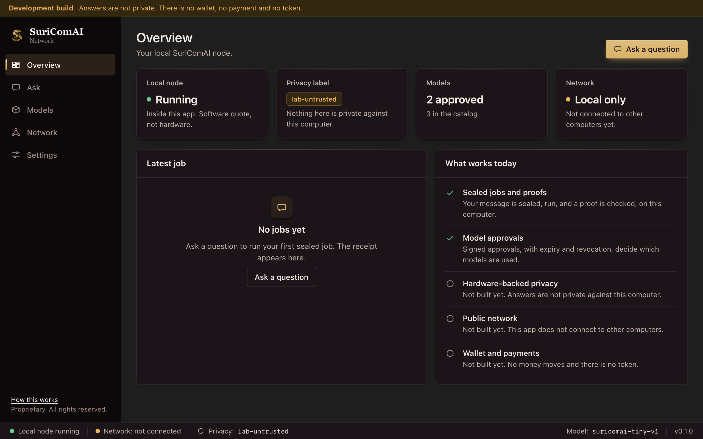</td>
    <td width="50%">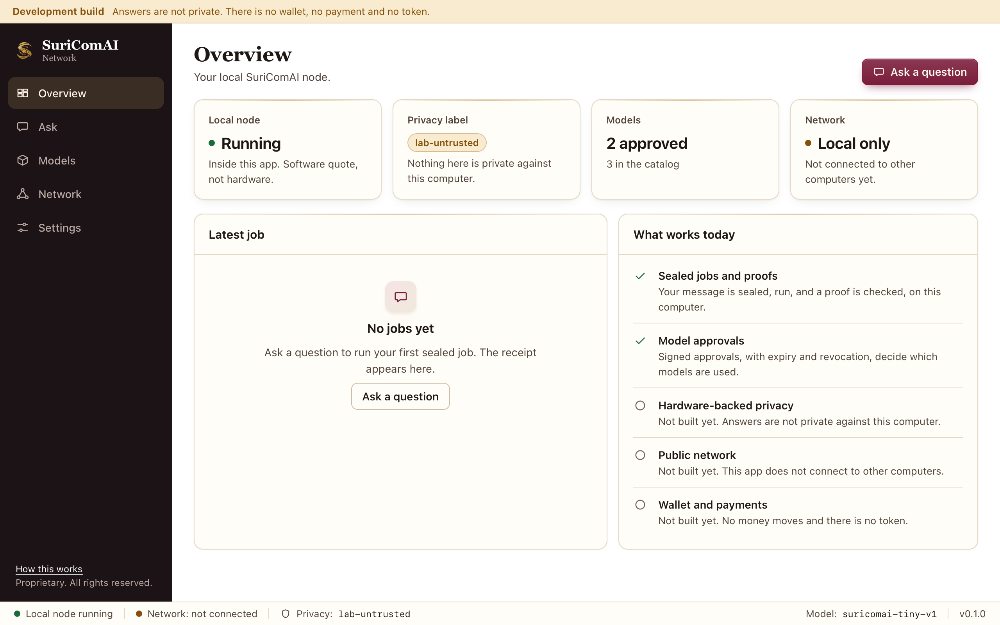</td>
  </tr>
  <tr>
    <td><sub><b>Windows.</b> Segoe UI Variable, compact controls, accent bar.</sub></td>
    <td><sub><b>Linux, light theme.</b> Flat, rounded, generous spacing.</sub></td>
  </tr>
  <tr>
    <td>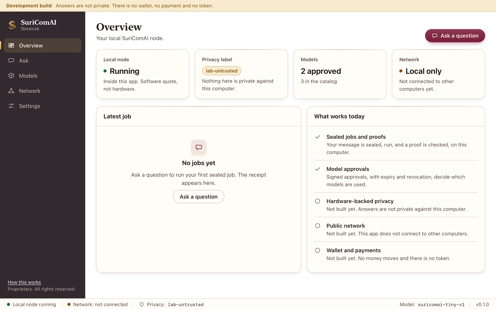</td>
    <td>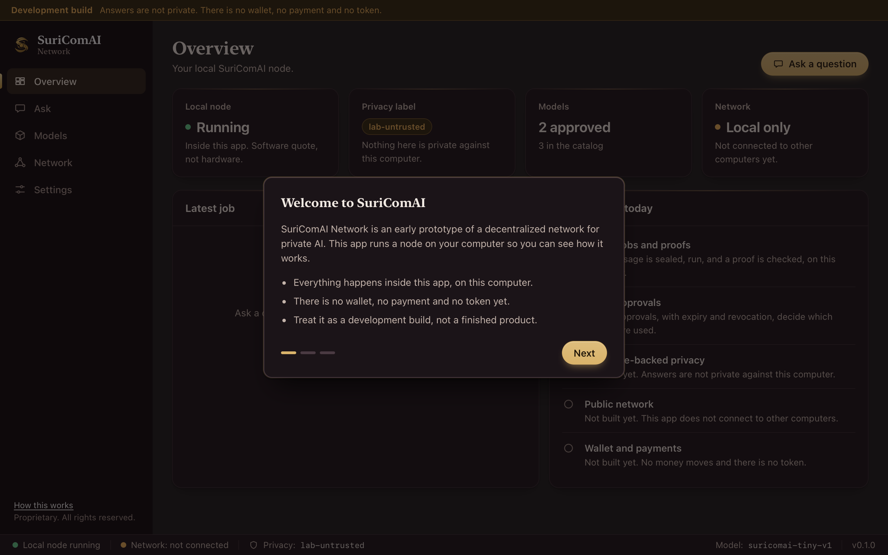</td>
  </tr>
  <tr>
    <td><sub><b>macOS, light theme.</b> SF Pro, pill controls, translucent sidebar.</sub></td>
    <td><sub><b>First run.</b> A three-step guide explains the privacy labels.</sub></td>
  </tr>
</table>

<sub>Screenshots show the interface with sample data, rendered from the app's own pages on macOS. The Windows and Linux images show those systems' style on the same renderer, not captures from those systems.</sub>

Installers (`.dmg`, `.exe`, `.msi`, `.AppImage`, `.deb`) are built by the release workflow and are not yet code-signed. See [docs/desktop-app.md](docs/desktop-app.md#installers). Platform support is in [docs/platforms.md](docs/platforms.md).

## A small model for testing

[`suricomai-mini-chat`](docs/mini-model.md) is a 2.2 million parameter model trained for this project. It answers in plain sentences, runs on any processor and ships in the repository (4.3 MB), so the whole flow can be tested without a graphics card:

```bash
scripts/try-mini-model.sh "What is the capital of Japan?"
```

## Real and not real

**Real:** the sealing and proof cryptography, the escrow rules and the contract, the committee signer, the model approval system, and a model that really runs when you install its weights.

**Unverified contract work:** the escrow contract was rewritten for the itemized fee schedule, but its Solidity tests have never been compiled or run, because the Solidity toolchain could not be set up. Treat the contract as unverified and unaudited.

**Stand-ins, compiled only with `--features lab`:** the software quote (it proves nothing about hardware, because whoever holds its key can produce any quote), the built-in test model, and the development approver key that is published in the source. A default or release build of the shipping crates (`suricomai-envelope`, `suricomai-escrow`, `suricomai-attestor`) contains none of them. `scripts/check-release.sh` proves this on the compiled code and checks that the check itself can fail.

**Not built yet:** the hardware-backed private tier, separate worker, relay and attestor processes on a network, a deployed and audited contract, a wallet, and real payments. Until the hardware tier exists, no answer is private against the machine that ran it, and the client says so.

No software can promise to be unhackable. Security here comes from published cryptography and checks that fail closed, which anyone can read and test, not from secrecy.

## Repository layout

| Path | Purpose |
| --- | --- |
| [`contracts`](contracts) | `SuriComAIEscrow` contract, its tests, and the local end-to-end run |
| [`crates/suricomai-attestor`](crates/suricomai-attestor) | Committee signer: signs a settlement only after two verifiers agree |
| [`crates/suricomai-envelope`](crates/suricomai-envelope) | Sealing, canonical encoding, receipts, replay cache, proof audit |
| [`crates/suricomai-escrow`](crates/suricomai-escrow) | Typed job escrow: lock, prove, pay, expire, slash, refund |
| [`crates/suricomai-runtime`](crates/suricomai-runtime) | Development node, client, local models, and the `suricomai` CLI (needs `--features lab`) |
| [`crates/suricomai-testnet`](crates/suricomai-testnet) | In-process multi-role network simulator and gates |
| [`verifiers/python`](verifiers/python) | Independent proof verifier |
| [`vectors`](vectors) | Shared test vectors used by both verifiers |

## Roadmap

1. **Foundation** (done): sealed envelope, escrow, simulator, dual verifier, reference client.
2. **Measured enclave:** run the executor in an Intel TDX or AMD SEV-SNP guest and verify a real vendor quote on a second machine.
3. **Real nodes:** executors, relays, and attestors as separate processes over a network.
4. **Paid jobs on an existing chain:** an audited escrow contract on an Ethereum layer-2, paid in a stablecoin, with no new token. Settlement is attested by a bonded committee until on-chain verification is practical.
5. **Payment channels:** instant payments so a chat does not need one chain transaction per message.
6. **Wallet apps and a public network.**
7. **Own chain and token:** only if real paid usage and legal review show it is needed.

Each step ships only when its release gate passes. Nothing is labeled private or live before it is.

## FAQ

**What is SuriComAI?**
SuriComAI is a proprietary prototype of a decentralized network for private AI inference, written in Rust. The design lets users pay per job and hardware owners earn for useful work, with private jobs running inside confidential hardware. Today it is a reference implementation you run locally, not a live network.

**Is SuriComAI safe to use with real data or money?**
No. It is an unreviewed prototype. Nothing is private against the machine running it, and the escrow contract is unaudited and undeployed. Use it only to read the code and run local tests.

**Is SuriComAI live?**
No. It is a prototype: a working protocol, a reference client, and a reference escrow contract you can run locally. The public network is not launched, you cannot pay for jobs yet, and there is no token.

**Which models can I use?**
The approved ones. Every model has a signed manifest and a signed approval that expires and can be revoked. Today the list has a built-in test model and the optional SmolLM2-135M. See [Which models you can use](#which-models-you-can-use).

**Can I run my own model on the network?**
In a development setup, yes: publish a manifest, have approvers sign it, host the weights on a node you run, and ask it. See [Publishing a model](docs/publishing-models.md). The model must be a GGUF file of the llama architecture with a ChatML prompt layout, and it runs as a non-private job. It is used only by operators whose trust file lists approvers who signed it. There is no public network yet. Private jobs will accept approved models only.

**How will payments work?**
The plan is to pay per job in native USDC through an escrow contract on an existing Ethereum layer-2, with no new token at first. A job has one itemized price: the worker's price plus a protocol fee, an attestation fee and, if a relay was used, a relay fee, with hard caps and a full refund if the job fails. See [Payments and fees](docs/payments-and-fees.md). The contract and the signer exist as unaudited reference code, and the contract does not yet enforce that fee schedule. Nothing is deployed and no real money moves.

**Is there a token?**
No. Any token claiming to be SuriComAI is not from this project. A native token is a possible later step, only if real paid usage and legal review support it.

**Is my chat private today?**
Not in the hardware sense. On normal machines the client uses a lab quote and says `lab-untrusted`. Hardware-backed privacy needs Intel TDX or AMD SEV-SNP, which is the next milestone.

**Are prompts stored on a blockchain?**
Never. The chain only stores commitments and proofs. It never stores prompts, answers, or their ciphertext.

**How is this different from mining?**
Miners on Bitcoin burn power on puzzles that serve no other purpose. SuriComAI pays hardware for work people actually want: running models, relaying sealed jobs, and checking proofs.

**Can I earn with a gaming GPU?**
Yes, on non-private jobs. Private jobs need confidential-computing hardware, such as server CPUs with TDX or SEV-SNP and NVIDIA data-center GPUs. Earnings depend on market demand and are not guaranteed.

**Can I use it through an API?**
Only locally. The reference client includes an OpenAI-style `POST /v1/chat/completions` example that answers one request on your own machine. See `crates/suricomai-runtime/examples/chat_api.rs`.

**Does it run on Windows or Linux?**
It is developed and tested on macOS. Linux and Windows are not tested yet.

## Naming

The project is **SuriComAI Network**, written `SuriComAI` in prose and `suricomai` in code, crate names, commands, paths and protocol identifiers. Nothing in the repository uses the shorter name.

## Contributing

This project is not accepting outside contributions or pull requests. Please do not send code.

Security issues: please use this repository's private vulnerability reporting (the **Security** tab) instead of a public issue.

This project is a prototype and has not had an independent security review. Do not use it to protect real secrets or real funds.

## Licensing, purchase and takeover

**SuriComAI Network is proprietary software. All rights are reserved.** The source is visible so it can be read and reviewed. Visible does not mean free to use.

Without the Owner's prior written permission, you may not:

- use, run, test or deploy it, including for personal, educational or commercial work;
- copy, mirror or host it;
- modify it, fork it or build anything from it;
- redistribute, sell or sublicense it;
- rename or rebrand it, or present it as your own or as connected with us;
- use it, or what you learn from its code, to build a competing product.

The name **SuriComAI**, **SuriComAI Network** and the logos are our marks. Using them, including in the name of a copy or a fork, is not permitted.

**SuriComAI is for sale.** The owner will sell or license it to a serious buyer who has a concrete need for it. Price and terms are agreed in writing, so please say who you are and what you need when you get in touch.

**Want to license it, buy it, take it over, run a node, test it or audit it?** That is done by written agreement. Contact the owner through [github.com/suraj-chavda](https://github.com/suraj-chavda) and say what you want to do. Please do not start before there is an agreement.

Copying, renaming or reusing this project without permission is infringement, and we will act on it, including by notifying hosting platforms.

The full terms are in [LICENSE](LICENSE).

## License

Proprietary. Copyright (c) 2026 SuriComAI. All rights reserved. See [LICENSE](LICENSE).

<p align="center"><sub>Keywords: SuriComAI, AI prototype, decentralized AI inference, private AI inference, verifiable inference, AI proof of work alternative, confidential computing, TEE, Intel TDX, AMD SEV-SNP, post-quantum encryption, HPKE, ML-KEM, pay-per-use AI, GPU network, DePIN, Rust.</sub></p>
